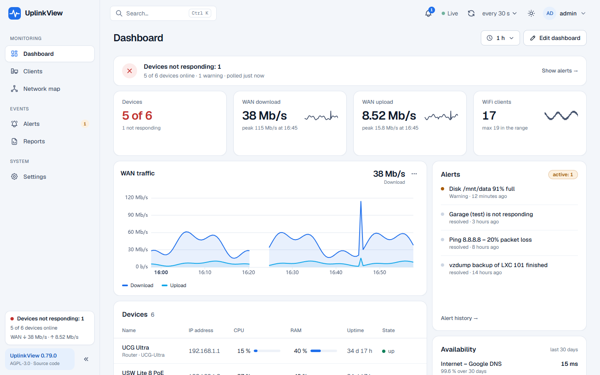
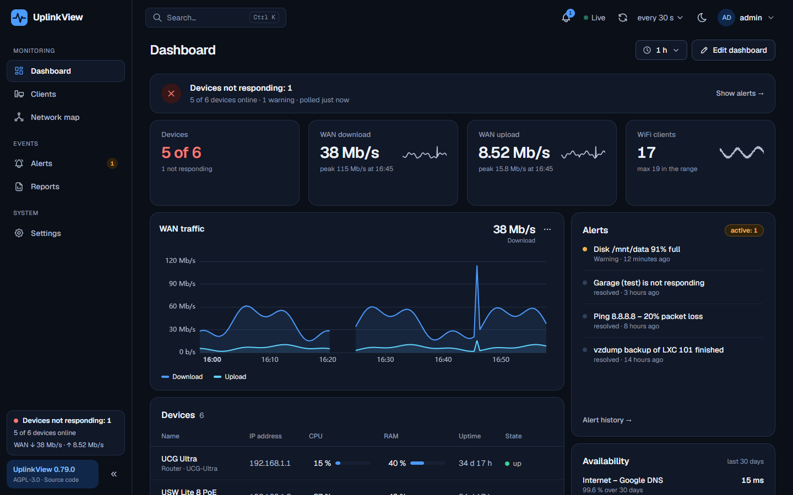
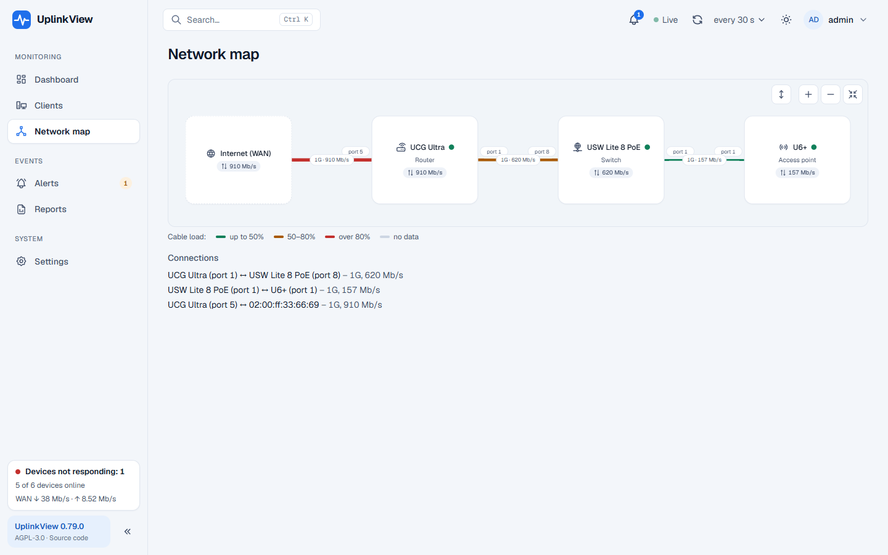

# UplinkView

**Self-hosted network monitoring for your homelab.** One dashboard for the traffic and port status of your router,
switches and access points – plus WiFi clients, a network map, dual WAN, Linux servers, Proxmox VE and alerts.

[Polski](README.pl.md) · [License: AGPL-3.0](LICENSE) · [Contributing](CONTRIBUTING.md)



## Install

One command on a clean Ubuntu Server. It installs Docker if needed, creates a `.env` file with random passwords and
starts all services:

```bash
curl -fsSL https://raw.githubusercontent.com/uplinkview/uplinkview/main/install.sh | sudo bash
```

Then open `http://SERVER-ADDRESS:8000` (or `https://SERVER-ADDRESS:8443`), create the administrator account and let
the setup wizard scan your network for devices.

Updates take one click in the panel (Settings → Update) or one command:

```bash
sudo uplinkview update
```

Every update is signed: the server only installs commits signed with a key it already trusts, and takes a database
backup first.

## Features

- **Dashboard** – device cards, WAN traffic with peaks, errors and drops, a live mode (WAN traffic every 1–2 s),
  several dashboards per account, Grafana-style charts (multiple sources, thresholds, comparisons, zoom), and read-only
  public dashboards for a wall display. Light and dark theme, English and Polish.
- **Devices and ports** – port state, speed, PoE, device / port / client detail pages, availability in percent,
  history for up to a year (hourly aggregates), automatic network discovery.
- **WiFi** – networks and clients with signal, presence and roaming history (UniFi Network API).
- **Network map** – topology from LLDP with cable load and speed.
- **Dual WAN** – link state, failover, SLA, latency to each link, gateway speed tests.
- **Servers** – Linux over SNMP or with the lightweight UplinkView agent (Docker containers, systemd services, SMART,
  temperatures) and Proxmox VE (VMs, LXC containers, storage, vzdump backups).
- **Availability checks** – ping (latency, loss, jitter), HTTP(S) with certificate expiry, TCP port, DNS.
- **Alerts** – device offline, port down, overload, CPU / RAM, disk, port errors, agent data; notifications by
  webhook (e.g. Telegram), ntfy and e-mail, quiet hours with a summary, maintenance windows, grouping by topology.
- **Administration** – user roles (admin / operator / viewer), two-factor login (TOTP), audit log, HTTPS with a local CA,
  encrypted secrets, backups from the panel, monthly PDF / CSV report, modules you can turn off.
- **Android app** – WAN traffic and a home-screen widget ([releases](https://github.com/uplinkview/uplinkview/releases)).





## Supported devices

| Vendor            | Status | Data sources |
|-------------------|--------|--------------|
| Ubiquiti UniFi    | ✅ tested on hardware (UCG Ultra, USW Lite 8 PoE, U6+) | SNMP (IF-MIB, UBNT-UniFi-MIB) + UniFi Network API |
| Linux servers     | ✅ | SNMP (`snmpd`) or the UplinkView agent |
| Proxmox VE        | ✅ tested on PVE 9.1 / 9.2 (single node) | Proxmox API (token, PVEAuditor role) |
| MikroTik          | ✅ tested on RouterOS 7.18 (CHR); sensors, PoE and SFP from the official MIB | SNMP (IF-MIB, MIKROTIK-MIB, HOST-RESOURCES-MIB) |
| TP-Link Omada     | SNMP driver from the official MIBs, waiting for real hardware | SNMP |
| Anything else     | ✅ basics | generic SNMP driver (IF-MIB) |

SNMP v1, v2c and v3 (authPriv). Got a device that doesn't look right? The **device report** on its detail page creates
an anonymized SNMP dump you can attach to a [new device request](https://github.com/uplinkview/uplinkview/issues/new?template=nowe-urzadzenie.yml).

## How it works

```
 [Router] [Switch] [AP] ──SNMP/API──►  Collector (async, every 30 s)  ◄── agent reports (push)
 [Proxmox] [UniFi controller]                 │
                                              ▼
                               PostgreSQL + TimescaleDB  ◄──  API (FastAPI)
                                                                 │  REST + WebSocket
                                                                 ▼
                                                      Web panel (React)
```

Each vendor is a driver with a common interface. The generic IF-MIB driver works with any SNMP device; vendor drivers
add the rest. The driver is picked automatically from `sysObjectID` / `sysDescr`.

| Layer       | Technology |
|-------------|------------|
| Collector   | Python 3.13, asyncio, `pysnmp` 7 |
| API         | FastAPI, Pydantic v2, SQLAlchemy 2 (async), asyncpg, Alembic |
| Database    | PostgreSQL 17 + TimescaleDB (hypertables, compression, continuous aggregates) |
| Panel       | React 19 + TypeScript, Vite, Tailwind CSS, TanStack Query, Apache ECharts |
| Deployment  | Docker Compose on Ubuntu Server, nginx proxy with HTTPS, separate `updater` container |

## Repository layout

```
backend/        # API, collector and Linux agent (shared models and drivers)
frontend/       # web panel (React + Vite)
updater/        # update and backup service
deploy/         # docker-compose.yml, proxy, .env.example
scripts/        # the `uplinkview` server command (update, status, logs, backup…)
mobile/android/ # Android app
install.sh      # one-line installer
docs/           # documentation (in Polish for now)
```

## Roadmap

- Optional paid cloud: access from outside your network and push notifications, with your history staying on your server.
- RouterOS and Omada controller APIs, Synology NAS – once there is real hardware to test on.

## License

UplinkView is free software under the [GNU AGPL-3.0](LICENSE). You can use it (also at work), change it and share it
at no cost. If you offer a modified version to others – including as a network service – you have to publish its source
code under the same license. Everything you install yourself is free with no limits; only the optional cloud will be paid.

Want to help? See [CONTRIBUTING.md](CONTRIBUTING.md). For a commercial license without the AGPL obligations, open an
issue on GitHub.
