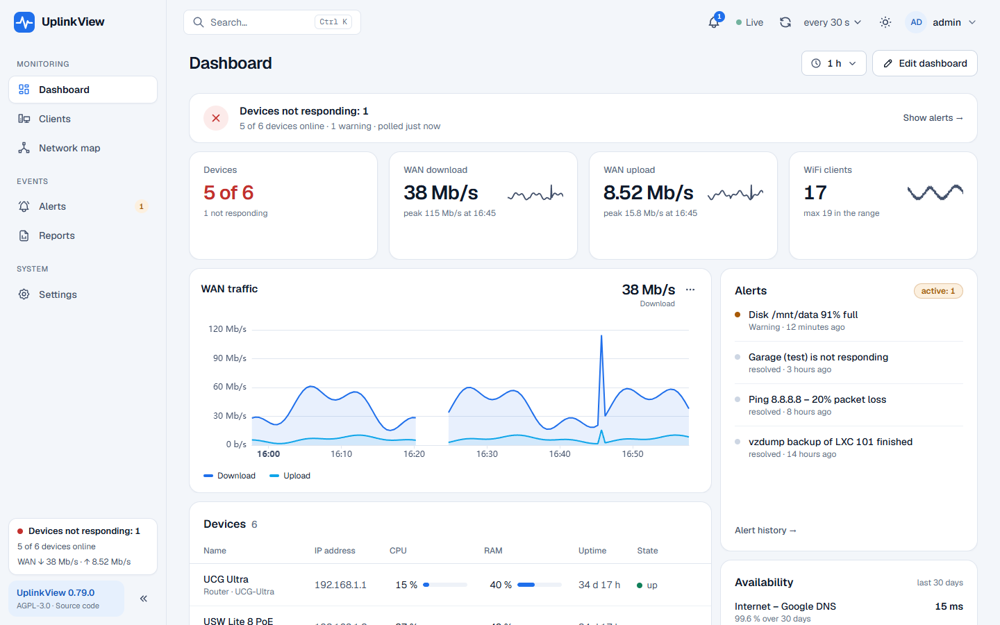
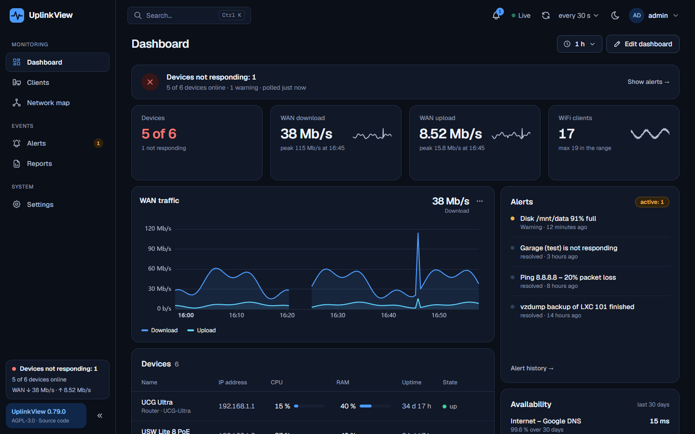
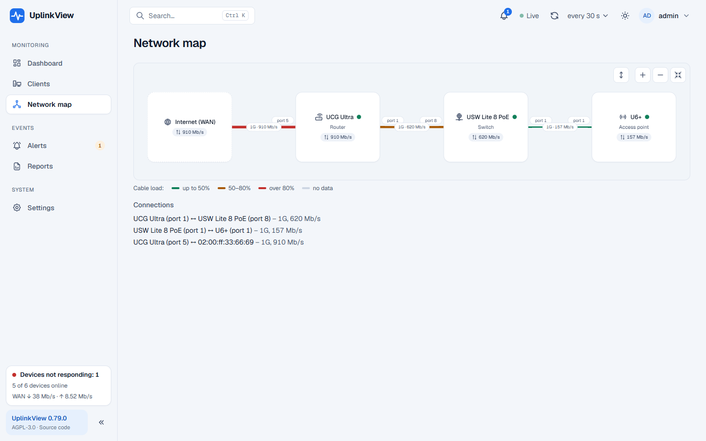

# UplinkView

**Monitoring sieci w homelabie, instalowany u siebie.** Jeden panel z ruchem i stanem portów routera, switchy
i access pointów, a do tego klienci WiFi, mapa sieci, dual WAN, serwery Linux, Proxmox VE i alerty.

[English](README.md) · [Współtworzenie](CONTRIBUTING.md)



## Instalacja

Jedna komenda na czystym Ubuntu Server. Instaluje Dockera, jeśli go brak, tworzy plik `.env` z losowymi hasłami
i uruchamia usługi:

```bash
curl -fsSL https://raw.githubusercontent.com/uplinkview/uplinkview/main/install.sh | sudo bash
```

Potem otwórz `http://ADRES-SERWERA:8000` (albo `https://ADRES-SERWERA:8443`), załóż konto administratora,
a kreator pierwszej konfiguracji przeskanuje sieć i pomoże dodać urządzenia.

Aktualizacja jednym kliknięciem w panelu (Ustawienia → Aktualizacja) albo poleceniem:

```bash
sudo uplinkview update
```

Każda aktualizacja jest podpisana: serwer instaluje tylko commity podpisane znanym mu kluczem, a przed zmianą
robi kopię zapasową bazy. Szczegóły: [`docs/04-instalacja-i-aktualizacja.md`](docs/04-instalacja-i-aktualizacja.md).

## Co potrafi

- **Pulpit** – karty urządzeń, ruch WAN (pobieranie i wysyłanie), błędy i dropy, tryb „Na żywo” (ruch WAN co 1–2 s), wiele pulpitów
  na koncie, wykresy w stylu Grafany (wiele źródeł, progi, porównania, powiększanie), pulpity publiczne tylko do odczytu
  na wyświetlacz ścienny. Motyw jasny i ciemny, polski i angielski.
- **Urządzenia i porty** – stan portów, prędkość, PoE, strony urządzenia, portu i klienta, dostępność w procentach,
  historia do roku (agregaty godzinowe), wykrywanie urządzeń w sieci.
- **WiFi** – sieci i klienci z historią sygnału, obecności i przejść między AP (UniFi Network API).
- **Mapa sieci** – topologia z LLDP z obciążeniem i prędkością kabli.
- **Dual WAN** – stan łączy, przełączenia, SLA, opóźnienie każdego łącza, testy prędkości bramy, zużycie transferu dzienne i miesięczne (opcjonalnie z pakietem).
- **Serwery** – Linux przez SNMP albo lekki agent UplinkView (kontenery Docker, usługi systemd, SMART, temperatury)
  i Proxmox VE (maszyny VM i LXC, magazyny, kopie vzdump).
- **Sprawdzanie dostępności** – ping (opóźnienie, utrata, jitter), HTTP(S) z ważnością certyfikatu, port TCP, DNS.
- **Alerty** – urządzenie offline, port down, przeciążenie, CPU / RAM, dysk, błędy portów, dane z agenta; powiadomienia
  webhookiem (np. Telegram), przez ntfy i e-mail, ciche godziny z podsumowaniem, okna serwisowe, grupowanie po topologii.
- **Administracja** – role kont (administrator / operator / podgląd), logowanie dwuskładnikowe (TOTP), dziennik zdarzeń,
  HTTPS z lokalnym CA, zaszyfrowane sekrety, kopie zapasowe z panelu, raport miesięczny PDF / CSV, wyłączane moduły.
- **Aplikacja Android** – ruch WAN i widget na ekran główny ([wydania](https://github.com/uplinkview/uplinkview/releases)).





## Obsługiwane urządzenia

| Producent         | Stan | Źródła danych |
|-------------------|------|---------------|
| Ubiquiti UniFi    | ✅ sprawdzone na sprzęcie (UCG Ultra, USW Lite 8 PoE, U6+) | SNMP (IF-MIB, UBNT-UniFi-MIB) + UniFi Network API |
| Serwery Linux     | ✅ | SNMP (`snmpd`) albo agent UplinkView |
| Proxmox VE        | ✅ sprawdzone na PVE 9.1 / 9.2 (jeden węzeł) | API Proxmox (token, rola PVEAuditor) |
| MikroTik          | ✅ sprawdzone na RouterOS 7.18 (CHR); czujniki, PoE i SFP z oficjalnego MIB | SNMP (IF-MIB, MIKROTIK-MIB, HOST-RESOURCES-MIB) |
| OPNsense          | ✅ sprawdzone na OPNsense 26.7 (VirtualBox): router, WAN z trasy domyślnej; bramy (opóźnienie, utrata), usługi, urządzenia z DHCP/ARP i ich ruch, wersja | SNMP (wtyczka `os-net-snmp`) + API OPNsense (klucz) |
| TP-Link Omada     | driver SNMP z oficjalnych MIB-ów, czeka na prawdziwy sprzęt | SNMP |
| Inne              | ✅ podstawowo | generyczny driver SNMP (IF-MIB) |

SNMP v1, v2c i v3 (authPriv). Urządzenie wygląda nie tak, jak powinno? **Raport urządzenia** na jego stronie tworzy
zanonimizowany zrzut SNMP, który można dołączyć do [zgłoszenia nowego urządzenia](https://github.com/uplinkview/uplinkview/issues/new?template=nowe-urzadzenie.yml).

## Jak to działa

```
 [Router] [Switch] [AP] ──SNMP/API──►  Kolektor (async, co 30 s)  ◄── raporty agenta (push)
 [Proxmox] [kontroler UniFi]                 │
                                             ▼
                               PostgreSQL + TimescaleDB  ◄──  API (FastAPI)
                                                                 │  REST + WebSocket
                                                                 ▼
                                                       Panel (React)
```

Każdy producent to driver ze wspólnym interfejsem. Driver generyczny (IF-MIB) działa z każdym urządzeniem ze SNMP,
drivery producentów dokładają resztę. Driver wybiera się sam według `sysObjectID` / `sysDescr`.

| Warstwa     | Technologia |
|-------------|-------------|
| Kolektor    | Python 3.13, asyncio, `pysnmp` 7 |
| API         | FastAPI, Pydantic v2, SQLAlchemy 2 (async), asyncpg, Alembic |
| Baza        | PostgreSQL 17 + TimescaleDB (hypertables, kompresja, agregaty ciągłe) |
| Panel       | React 19 + TypeScript, Vite, Tailwind CSS, TanStack Query, Apache ECharts |
| Wdrożenie   | Docker Compose na Ubuntu Server, proxy nginx z HTTPS, osobny kontener `updater` |

## Struktura katalogów

```
backend/        # API, kolektor i agent Linux (wspólne modele i drivery)
frontend/       # panel (React + Vite)
updater/        # usługa aktualizacji i kopii zapasowych
deploy/         # docker-compose.yml, proxy, .env.example
scripts/        # polecenie `uplinkview` na serwerze (update, status, logs, backup…)
mobile/android/ # aplikacja Android
install.sh      # instalator jednym linkiem
docs/           # dokumentacja
```

## Plany

- Opcjonalna płatna chmura: dostęp spoza sieci domowej i powiadomienia push, a historia zostaje na Twoim serwerze.
- API RouterOS i kontrolera Omada, Synology NAS – gdy będzie prawdziwy sprzęt do testów.

Pełny plan: [`docs/40-plan-dzialania.md`](docs/40-plan-dzialania.md).

## Współtworzenie

Chcesz pomóc? Zobacz [`CONTRIBUTING.md`](CONTRIBUTING.md).
